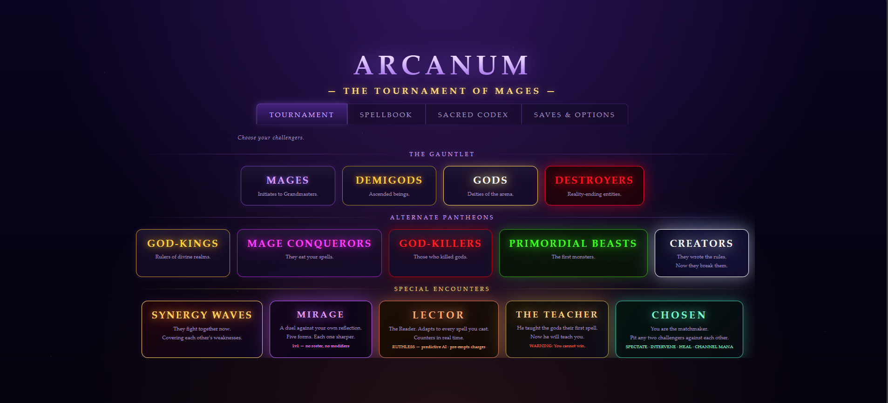

# Arcanum — The Tournament of Mages

A first-person 3D spellcasting arena game that runs entirely in your browser. Fight through tournaments of mages, gods and primordial beasts, chain spells into combos, and survive bosses that adapt to how you play.

**Play it:** `https://<your-username>.github.io/<repo-name>/`  *(replace after enabling GitHub Pages)*




## Features

- First-person 3D arena built with three.js (bundled in the file, no internet needed after loading)
- 20+ spells, combos, ultimates and potions
- Tournament modes plus special encounters (see below)
- Adaptive boss AI that reads your spell habits
- Desktop (keyboard + mouse) and mobile (touch controls) support
- Save and load: autosave after every round plus 3 manual slots
- Options: look sensitivity, invert Y, field of view, graphics quality, flash and shake reduction, FPS counter
- Single file, no install, no build step

## Game modes

**The Gauntlet:** Mages, Demigods, Gods, Destroyers
**Alternate Pantheons:** God-Kings, Mage Conquerors, God-Killers, Primordial Beasts, Creators
**Special Encounters:**

| Mode | Description |
|---|---|
| Synergy Waves | Enemies fight together and cover each other's weaknesses |
| Mirage | 1v1 duel against your own reflection, five forms |
| Lector | "The Reader" — a three-phase boss that adapts to your spells and counters in real time |
| The Teacher | A fight you are not meant to win; learn from each defeat |
| Chosen | You are the matchmaker: pit any two challengers against each other and spectate or intervene |

## Controls

### Desktop

| Input | Action |
|---|---|
| `W A S D` | Move |
| `Shift` | Sprint |
| `Space` | Jump (at full mana: Awakened State) |
| Mouse | Look (click the game to capture the mouse) |
| `LMB` (hold + release) | Fire Bolt |
| `RMB` (hold + release) | Stone Projectile |
| `E` (hold + release) | Lightning |
| `F` | Heal |
| `Q` | Shield (click to toggle, hold to reinforce) |
| `V` (hold) | Void Funnel |
| `C` | Kinetic Blast (click) / Telekinetic Grab (hold) |
| `R` | Time Stop |
| `G` | Undead Army |
| `X` | Rabbit Swarm |
| `1` / `2` | Divine Sword / Mirror Shield |
| `B` | Blood Pact (sacrifice HP for mana) |
| `T` | Summon Dragon |
| `Z` | Blink |

**Combos:** `E+RMB` Storm Fury · `E+LMB` Thunderbolt · `C+LMB` Flame Dash · `C+E` Railgun · `F+E` Healing Storm · `C+Q` Force Push · hold `Q` while casting to overcharge.

The in-game **Spellbook** button lists every spell, and the **Sacred Codex** in the main menu has the lore.

### Mobile

- **Left joystick:** move (push to the edge to sprint)
- **Drag anywhere else:** look around
- **Right-hand buttons:** Fire, Stone, Bolt, Jump, Heal, Shield, Kinetic. Hold to charge, release to cast.
- **☰ button:** opens the rest of the spells and potions
- Best played in **landscape**. The game requests fullscreen on your first tap.

## Run it locally

No build step. Just open the file:

```bash
git clone https://github.com/<your-username>/<repo-name>.git
cd <repo-name>
# open index.html in a modern browser
```

Or serve it locally:

```bash
python3 -m http.server 8000
# then visit http://localhost:8000
```

## Deploy with GitHub Pages

1. Name the game file `index.html` in the repo root.
2. Go to **Settings → Pages**.
3. Under **Build and deployment**, choose **Deploy from a branch**, then `main` and `/ (root)`.
4. Save. The site goes live after a minute or two.

## Browser support

Requires WebGL. Tested approach targets current Chrome, Edge, Firefox and Safari on desktop, and Chrome / Safari on phones. Older or low-end phones may drop frames in large late-game fights.

## Saves and options

Open **Saves & Options** from the main menu, or scroll down in the in-game **Spellbook** panel.

- **Autosave** runs after each cleared round (can be turned off). There are also three manual slots.
- A save records your tournament mode, round and score. Loading restarts at the beginning of that round, with health and mana refilled as normal.
- Saving works in the tournament modes (Mages through Creators, and Synergy Waves). Mirage, Lector, The Teacher and Chosen are single encounters and are not saved.
- **Options** include look sensitivity, invert vertical look, field of view, graphics quality (Low / Medium / High), screen flash intensity, camera shake, FPS counter, and a one-tap **Reduce flashes & shake** comfort preset.
- **Delete all saved data** wipes every save and setting, and shows the photosensitivity warning again.

## Privacy

The game runs entirely on your device. It makes no network requests and has no analytics, tracking, cookies or third-party scripts. It uses your browser's local storage only to keep your saves, settings and the fact that you accepted the health warning. That data stays on your device and is never sent anywhere. Clearing your browser data, or using **Delete all saved data**, removes it. Because nothing is collected, there is no personal data to request or delete from a server.

## Health notice

> **Photosensitivity warning:** the game shows this notice on first launch. It contains flashing lights, screen flashes and strobing visual effects that may trigger seizures in people with photosensitive epilepsy. Stop playing and consult a doctor if you feel dizzy, disoriented or experience involuntary movements.

## Known limitations

- Not designed for screen readers; it is a real-time first-person action game.
- Controls cannot currently be remapped.
- Saves are per browser and per device, and can't be transferred between them. Clearing browser data erases them.
- Mid-fight state is not saved; loading returns you to the start of the saved round.

## Credits and licenses

- Game design and code: **<your name / handle>**
- 3D rendering: [three.js](https://threejs.org/), MIT License, bundled in the game file. Keep its copyright notice if you redistribute.
- All characters, names and lore are original to this project. Any resemblance to existing trademarks is unintentional; if you fork it, avoid using third-party brand names.
